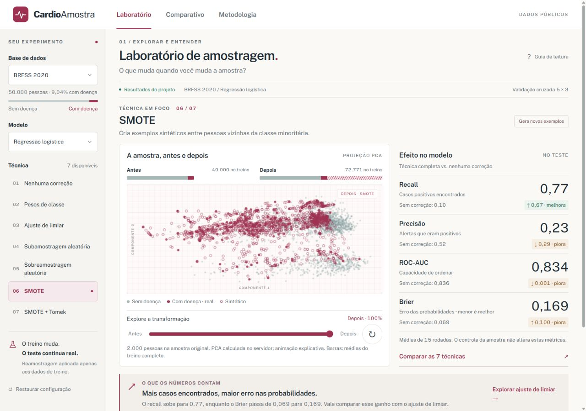
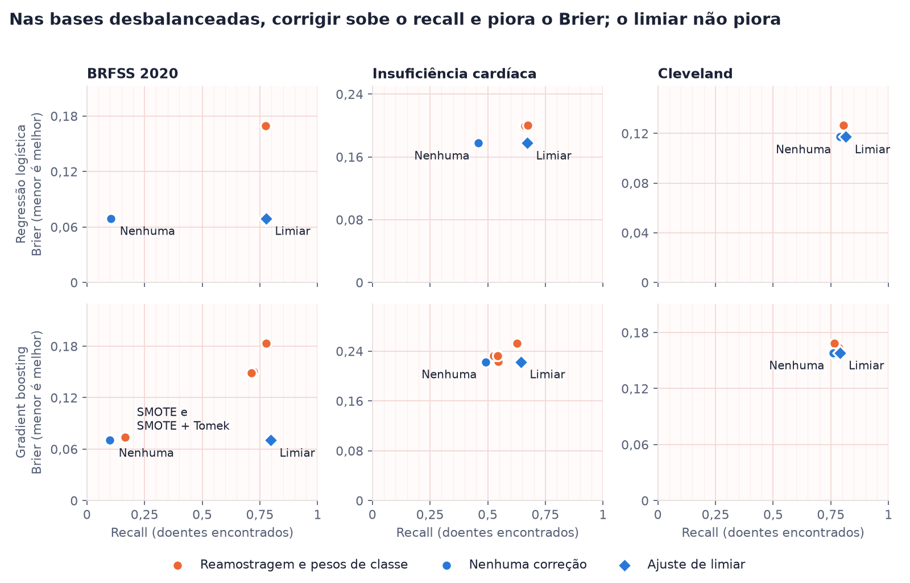

# CardioAmostra

Painel que compara, lado a lado, como 7 técnicas para lidar com o desbalanceamento de classes
mudam a detecção de doença cardíaca e as probabilidades do modelo.

> **Projeto educativo com dados públicos. Não serve para diagnóstico nem para avaliar o risco
> de um paciente.**



**Painel online:** [https://cardioamostra-8h6d8kmb9qysg4yrafgyz9.streamlit.app/](https://cardioamostra-8h6d8kmb9qysg4yrafgyz9.streamlit.app/) ·
**Relatório (PDF, 5 páginas):** [relatorio/relatorio.pdf](relatorio/relatorio.pdf)

## O que descobrimos

Na BRFSS 2020, onde só 9% das pessoas têm doença cardíaca:

- **Toda correção encontra mais doentes.** Com regressão logística, pesos de classe,
  subamostragem, sobreamostragem, SMOTE e SMOTE + Tomek levam o recall de **0,10 para 0,78**.
- **Mas o modelo passa a exagerar o risco.** Ele prevê cerca de **4 vezes** o risco real, e o
  Brier sobe de 0,069 para 0,170 (pior em 15 de 15 rodadas). A capacidade de ordenar os
  pacientes (ROC-AUC 0,836) não melhora com nenhuma técnica.
- **Ajustar o limiar de decisão dá o mesmo recall sem esse custo:** recall de 0,78 com Brier de
  0,069. As probabilidades continuam corretas.
- **SMOTE com gradient boosting falha nesta base** (recall de 0,16): o SMOTE cria pacientes com
  valores impossíveis, como 7,3 dias, e as árvores aprendem a reconhecê-los. Arredondando, o
  recall volta a 0,71.



Encontrar mais doentes custa alarmes falsos com qualquer técnica: em 1.000 pessoas, ir de recall
0,10 para 0,78 encontra 61 doentes a mais e gera 228 alarmes falsos a mais. Onde cortar é uma
decisão clínica; o ajuste de limiar a deixa explícita. As 8 conclusões, com as tabelas
completas, estão no [relatório](relatorio/relatorio.pdf).

## Como rodar

```bash
python -m venv .venv
source .venv/Scripts/activate        # Windows (Git Bash); no Linux/Mac: source .venv/bin/activate
pip install -r requirements-dev.txt  # só o painel: pip install -r requirements.txt

streamlit run app/painel.py          # o painel (usa os resultados prontos em resultados/)
python -m pytest                     # testes
```

A interface compacta roda no próprio Streamlit (versão 1.56 ou superior), sem Node ou
servidor frontend separado. Laboratório, Comparativo e Metodologia compartilham a seleção
de base, modelo e técnica. O comparativo inclui ordenação, exportação CSV e curvas de
calibração com seus valores por faixa.

O servidor lê os Parquet em `resultados/` e calcula a PCA das amostras, com cache invalidado
quando os arquivos mudam. O controle antes/depois é uma animação explicativa: não treina
modelos nem altera as métricas pré-calculadas. Amostras ou curvas ausentes exibem um aviso
sem impedir a consulta das métricas disponíveis. `CARDIOAMOSTRA_RESULTADOS` permite usar
outra pasta de resultados.

Os arquivos visuais ficam em `app/interface/`; o contrato de dados, em
`src/cardioamostra/interface.py`. O protótipo aprovado em `prototipo/` é uma referência
separada e não é carregado pela aplicação.

Para refazer todos os números do zero:

```bash
python scripts/baixar_dados.py       # baixa as 3 bases para dados/brutos/
python scripts/refazer_tudo.py       # experimentos, calibração e investigação (~20 min)
python scripts/gerar_figuras.py      # figuras do relatório
python scripts/gerar_relatorio.py    # relatorio/relatorio.pdf
```

A semente é fixa (42) e cada arquivo de `resultados/` guarda nos metadados a data, o commit do
código e os parâmetros (`cardioamostra.experimento.ler_metadados(caminho)`).

## Bases de dados

| Base | Pacientes | Com doença | Licença | Fonte |
|---|---|---|---|---|
| Personal Key Indicators of Heart Disease (BRFSS 2020) | 301.717 (após remover 18.078 duplicatas) | 9,04% (≈ 10:1) | [CC0 1.0](https://creativecommons.org/publicdomain/zero/1.0/) | [Kaggle – K. Pytlak](https://www.kaggle.com/datasets/kamilpytlak/personal-key-indicators-of-heart-disease) |
| Heart Failure Clinical Records | 299 | 32,1% de óbitos | CC BY 4.0 | [UCI ML Repository, id 519](https://archive.ics.uci.edu/dataset/519/heart+failure+clinical+records) |
| Heart Disease – Cleveland | 303 | 45,9% (controle quase equilibrado) | CC BY 4.0 | [UCI ML Repository, id 45](https://archive.ics.uci.edu/dataset/45/heart+disease) |

As bases brutas não ficam no repositório (`python scripts/baixar_dados.py` ou
`dados/brutos/LEIA-ME.md`). O painel usa só amostras de até 2.000 pessoas de cada base, gravadas
em `resultados/amostra_*.parquet`.

**Preparação** (`src/cardioamostra/dados.py`, `carregar(base)` devolve `(X, y)`):

- **BRFSS:** remoção das duplicatas antes de codificar; `AgeCategory` e `GenHealth` viram
  ordinais; Yes/No viram 0/1; `Race` e `Diabetic` recebem one-hot.
- **Insuficiência cardíaca:** alvo `DEATH_EVENT`. A coluna `time` (dias de acompanhamento) é
  **removida**: só é conhecida depois do desfecho e vazaria a resposta.
- **Cleveland:** alvo `num > 0`. Os 6 ausentes (`ca` 4, `thal` 2) recebem a moda; `cp`,
  `restecg`, `slope` e `thal` recebem one-hot.

**Citações**

- Pytlak, K. *Personal Key Indicators of Heart Disease*. Kaggle, 2022. Dados derivados do Behavioral Risk Factor Surveillance System (BRFSS) 2020, CDC.
- Chicco, D.; Jurman, G. Machine learning can predict survival of patients with heart failure from serum creatinine and ejection fraction alone. *BMC Medical Informatics and Decision Making*, 20, 16, 2020. Base: *Heart Failure Clinical Records*, UCI Machine Learning Repository, 2020. https://doi.org/10.24432/C5Z89R
- Janosi, A.; Steinbrunn, W.; Pfisterer, M.; Detrano, R. *Heart Disease*. UCI Machine Learning Repository, 1988. https://doi.org/10.24432/C52P4X

## Protocolo experimental

- **Validação cruzada estratificada 5 × 3** (5 partes, 3 repetições, semente 42): 15 rodadas
  por configuração.
- **A reamostragem acontece só nas partes de treino**, dentro de um `Pipeline` do
  imbalanced-learn (`escala → reamostragem → modelo`). O teste
  `test_nenhuma_linha_sintetica_chega_ao_teste` falha se isso mudar.
- **2 modelos fixos:** `LogisticRegression(max_iter=2000)` e
  `HistGradientBoostingClassifier(max_iter=200, learning_rate=0.1, max_leaf_nodes=31)`.
- **BRFSS em subconjunto estratificado de 50.000 pessoas**, como no artigo da IJACSA: o SMOTE +
  Tomek na base completa é lento demais.
- **Calibração** (`src/cardioamostra/calibracao.py`): curva de 10 faixas, razão previsto ÷
  observado, intercepto e inclinação de calibração, com as probabilidades fora da amostra da
  1ª repetição (cada pessoa aparece uma vez).

| Chave | Estratégia | O que faz |
|---|---|---|
| `nenhuma` | Nenhuma correção | Treina com os dados como estão, limiar 0,5 |
| `pesos` | Pesos de classe | `class_weight="balanced"`, nenhuma linha criada |
| `limiar` | Ajuste de limiar | Limiar escolhido no treino (validação interna de 3 partes) para alcançar o maior recall médio entre as 4 técnicas de reamostragem da mesma base e modelo |
| `subamostragem` | Subamostragem aleatória | `RandomUnderSampler` |
| `sobreamostragem` | Sobreamostragem aleatória | `RandomOverSampler` |
| `smote` | SMOTE | `SMOTE(k_neighbors=5)`, exige pelo menos 6 doentes por parte de treino |
| `smote_tomek` | SMOTE + Tomek | `SMOTETomek` |

Para acrescentar uma técnica (ADASYN, Borderline-SMOTE...), basta uma linha em
`src/cardioamostra/estrategias.py`; o experimento e o painel se montam a partir do registro.

### Arquivos de resultados

| Arquivo | Conteúdo | Gerado por |
|---|---|---|
| `comparacao.parquet`, `baseline.parquet` | Formato longo: `base, modelo, estrategia, rodada, metrica, valor` (recall, precisão, F1, PR-AUC, ROC-AUC, Brier e as contagens de treino antes e depois) | `rodar_experimentos.py` |
| `predicoes_comparacao.parquet` | Probabilidade fora da amostra de cada pessoa na 1ª repetição | `rodar_experimentos.py` |
| `calibracao_curvas.parquet`, `calibracao_resumo.parquet` | Curvas de 10 faixas e medidas de calibração | `analisar.py` |
| `tabela_final.parquet`, `tabela_final.csv` | Médias das 15 rodadas + calibração, uma linha por configuração | `analisar.py` |
| `amostra_<base>.parquet` | Até 2.000 pessoas por base, para a projeção PCA do painel | `analisar.py` |
| `investigacao_smote_gb.csv` | SMOTE × gradient boosting, com e sem arredondar os inteiros | `investigar_smote_gb.py` |

## Limitações

- Os experimentos na BRFSS usam 50.000 das 301.717 pessoas (mesma proporção de doentes).
- O arquivo do Kaggle não tem os pesos amostrais do BRFSS: os resultados valem para o modelo,
  não para a população dos EUA.
- Hiperparâmetros fixos: o objetivo é comparar técnicas, não achar o melhor modelo.
- O recall-alvo do ajuste de limiar vem da média das técnicas de reamostragem nas partes de
  teste; o limiar em si é escolhido só no treino.
- O SMOTE trata variáveis inteiras e categóricas como contínuas (ver a conclusão sobre o
  gradient boosting); o SMOTENC é o próximo passo.
- Nas bases pequenas (299 e 303 pacientes) as métricas variam muito entre rodadas.

## Estrutura

```
src/cardioamostra/   dados, estratégias, experimento, calibração, apresentação e interface (lógica testável)
app/                 painel Streamlit (telas Laboratório, Comparativo e Metodologia)
app/interface/       a interface em HTML, CSS e JS, carregada como componente do Streamlit
prototipo/           protótipo estático que originou a interface (não é usado pelo painel)
scripts/             baixar dados, rodar experimentos, analisar, figuras, relatório, GIF
resultados/          resultados versionados (.parquet e .csv)
relatorio/           relatório em Markdown e PDF
figuras/             figuras do README e do relatório
notebooks/           só exploração (Fase 1)
tests/               pytest (dados, estratégias, experimento, calibração, interface e painel)
```

## Equipe

| Pessoa | Papel | Entregas |
|---|---|---|
| 1 | Dados (Fases 0 e 1) | `dados.py`, testes de contagem e notebook exploratório |
| 2 | Experimentos (Fases 2 e 3) | `estrategias.py`, `experimento.py`, teste anti-vazamento e `comparacao.parquet` |
| 3 | Análise e calibração (Fase 4) | `calibracao.py`, tabela final, conclusões e relatório em PDF |
| 4 | Painel (Fase 5) | App Streamlit com as telas Laboratório, Comparativo e Metodologia |
| 5 | Coordenação, qualidade e comunicação (Fases 0 e 6) | CI, README, GIF e post |

## Como contribuir

1. Crie uma branch para a sua tarefa: `git checkout -b nome-da-tarefa`.
2. Faça os commits e envie: `git push -u origin nome-da-tarefa`.
3. Abra um pull request no GitHub e peça revisão.
4. O GitHub Actions roda `ruff`, `mypy` e `pytest` em todo PR (Python 3.10 com pandas 2 e
   Python 3.12 com pandas 3). Rode `python -m pytest` e `ruff check .` antes de pedir revisão.

## Referências

- van den Goorbergh, R. et al. The harm of class imbalance corrections for risk prediction models: illustration and simulation using logistic regression. *JAMIA*, 29(9), 2022.
- *Tipping the balance: impact of class imbalance correction on clinical risk prediction models*. JAMIA, 2026 (preprint).
- Tangprasert et al. Explainable Machine Learning for Cardiovascular Disease Prediction Using BRFSS Health Indicators. *IJACSA*, 17(8), 2026.
- [imbalanced-learn](https://imbalanced-learn.org/), a biblioteca de todas as técnicas de reamostragem.
