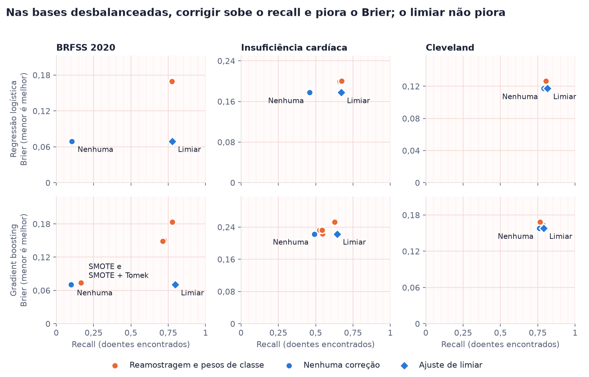
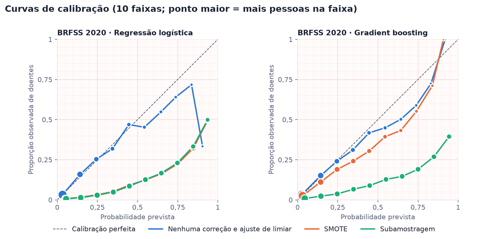
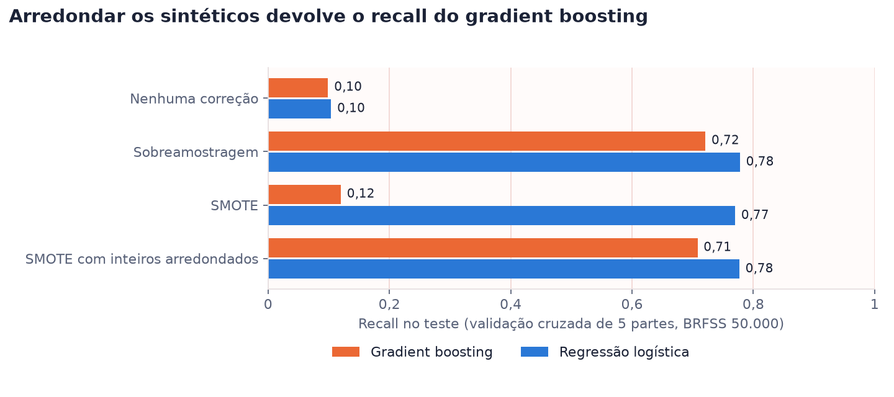

# CardioAmostra: o que a reamostragem faz com a detecção de doença cardíaca

**Equipe CardioAmostra** · novembro de 2026 · Projeto educativo com dados públicos, sem valor diagnóstico.

Comparamos 7 estratégias para lidar com o desbalanceamento de classes, com 2 modelos e 3 bases públicas. Na BRFSS 2020, onde só 9% das pessoas têm doença cardíaca, qualquer técnica de reamostragem ou de pesos sobe o recall da regressão logística de 0,10 para cerca de 0,78. O custo aparece nas probabilidades: o modelo passa a prever cerca de 4 vezes o risco real, e o Brier vai de 0,069 para 0,170. O **ajuste do limiar de decisão** chega ao mesmo recall com o Brier intacto. Nenhuma técnica melhora a ROC-AUC.

## 1. Pergunta e bases

A pergunta do projeto é: em dados clínicos desbalanceados, qual técnica de amostragem melhora de verdade a detecção dos doentes, e a que custo?

| Base | Pessoas | Com doença | Papel no estudo |
|---|---|---|---|
| BRFSS 2020 (Kaggle, CC0), após remover 18.078 duplicatas | 301.717 (subconjunto de 50.000 nos experimentos) | 9,04% | Base principal, desbalanceada (≈ 10:1) |
| Heart Failure Clinical Records (UCI 519, CC BY 4.0) | 299 | 32,1% (óbito) | Base clínica pequena (≈ 2:1) |
| Heart Disease Cleveland (UCI 45, CC BY 4.0) | 303 | 45,9% | Controle, quase equilibrada |

Na base de insuficiência cardíaca removemos a coluna `time` (dias de acompanhamento), que só é conhecida depois do desfecho e vazaria a resposta.

## 2. Protocolo

- **Validação cruzada estratificada 5 × 3** (5 partes, 3 repetições, semente 42): cada configuração é avaliada em 15 rodadas.
- **A reamostragem só acontece nas partes de treino**, dentro de um `Pipeline` do imbalanced-learn. Um teste automático falha se alguma linha sintética chegar à parte de teste.
- **7 estratégias:** nenhuma correção, pesos de classe, ajuste de limiar, subamostragem aleatória, sobreamostragem aleatória, SMOTE e SMOTE + Tomek.
- **2 modelos com configuração fixa:** regressão logística e gradient boosting (`HistGradientBoostingClassifier`, 200 árvores).
- **Ajuste de limiar:** o modelo treina sem correção. O limiar é escolhido só no treino, por validação cruzada interna de 3 partes, para alcançar o maior recall médio entre as 4 técnicas de reamostragem da mesma base e modelo. Assim a comparação fica em pé de igualdade.
- **BRFSS:** subconjunto estratificado de 50.000 pessoas, como no artigo da IJACSA (o SMOTE + Tomek na base completa é lento demais).
- **Métricas:** recall, precisão, F1, PR-AUC, ROC-AUC e Brier (médias das 15 rodadas). Para a calibração, usamos as probabilidades fora da amostra da 1ª repetição, em que cada pessoa aparece uma vez: curva de 10 faixas, razão previsto ÷ observado, intercepto e inclinação de calibração (as medidas de van den Goorbergh et al., 2022).

Tudo é refeito com `python scripts/refazer_tudo.py` (cerca de 20 minutos); o código e as instruções estão no README do repositório.

## 3. Resultados

**Tabela 1.** BRFSS 2020, regressão logística. *Prev. ÷ real*: risco médio previsto ÷ proporção real de doentes (1 é o ideal). *Intercepto*: 0 é o ideal; negativo, risco superestimado.

{{tabela:brfss:regressao_logistica}}

**Tabela 2.** BRFSS 2020, gradient boosting.

{{tabela:brfss:gradient_boosting}}

**Tabela 3.** Bases pequenas. As 5 correções são pesos de classe e as 4 técnicas de reamostragem; aparece a faixa dos valores delas.

{{tabela:pequenas}}

**Figura 1.** Cada ponto é uma técnica. Nas bases desbalanceadas, as correções (laranja) andam para a direita, porque encontram mais doentes, e para cima, porque erram mais as probabilidades. O ajuste de limiar (losango) anda só para a direita.

**Figura 2.** Calibração na BRFSS. Com regressão logística, SMOTE e subamostragem ficam bem abaixo da diagonal: quando dizem entre 40% e 60% de risco, só 9% a 13% das pessoas são doentes. A curva da nenhuma correção também é a do ajuste de limiar, que não muda as probabilidades.

## 4. Conclusões

1. **Em dados desbalanceados, toda correção sobe o recall.** Na BRFSS com regressão logística, o recall vai de 0,10 para 0,77 a 0,78 com qualquer uma das 5 correções (Tabela 1, linha *Nenhuma correção* contra as 5 linhas de correção). Na insuficiência cardíaca, de 0,46 para 0,66 a 0,67 (Tabela 3, linha *Insuficiência · regressão logística*).
2. **O ganho não vem de um modelo melhor.** Nenhuma técnica melhora a ROC-AUC ou a PR-AUC. Na BRFSS, a ROC-AUC fica em 0,834 a 0,836 contra 0,836 sem correção (regressão logística) e em 0,818 a 0,823 contra 0,828 (gradient boosting) (Tabelas 1 e 2, coluna ROC-AUC). As técnicas só mudam onde o modelo corta, não o quanto ele sabe ordenar os pacientes.
3. **O custo é a calibração.** Com reamostragem ou pesos, a regressão logística na BRFSS prevê 3,9 a 4,0 vezes o risco real (intercepto de −2,34 a −2,36), e o Brier sobe de 0,069 para 0,169 a 0,170, pior em 15 de 15 rodadas (Tabela 1, colunas Brier e Prev. ÷ real; Figura 2).
4. **O ajuste de limiar entrega o mesmo recall sem esse custo.** Na BRFSS, o recall chega a 0,78 com Brier de 0,069 e razão previsto ÷ real de 1,00 (Tabela 1, linha *Ajuste de limiar*). No gradient boosting, recall de 0,80 com Brier de 0,070 (Tabela 2, linha *Ajuste de limiar*).
5. **Encontrar mais doentes custa alarmes falsos, com qualquer técnica.** Em cada 1.000 pessoas da BRFSS, passar do recall de 0,10 para 0,78 encontra 61 doentes a mais (de 9 para 70) e gera 228 alarmes falsos a mais (de 9 para 237): a precisão cai de 0,52 para 0,23 (Tabela 1, coluna Precisão). Onde cortar é uma decisão clínica, e o ajuste de limiar a deixa explícita.
6. **Sem desbalanceamento, as técnicas quase não mudam nada.** Na Cleveland (46% de doentes), com regressão logística, o recall vai de 0,79 para 0,80 a 0,81, e o Brier de 0,117 para 0,118 a 0,127 (Tabela 3, linha *Cleveland · regressão logística*).
7. **SMOTE com gradient boosting falha nesta base.** O recall fica em 0,16 (Tabela 2, linha *SMOTE*). A causa: 24 das 25 colunas da BRFSS só têm números inteiros, e 99% dos pacientes sintéticos têm algum valor impossível (como 7,3 dias de saúde ruim). O modelo aprende a reconhecer o sintético por isso: dá 0,98 de probabilidade aos sintéticos e 0,27 aos doentes reais. Arredondando os inteiros, o recall volta a 0,71, perto dos 0,72 da sobreamostragem (Figura 3).
8. **Na base pequena, o recall oscila, mas a piora da calibração é consistente.** Na insuficiência cardíaca, o desvio-padrão do recall entre rodadas vai de 0,10 a 0,16, mais do que a diferença entre as técnicas. Já a piora do Brier com regressão logística (+0,020 a +0,023) aparece em 14 ou 15 das 15 rodadas (Tabela 3).

**Figura 3.** Recall no teste com e sem arredondar os inteiros dos pacientes sintéticos (validação cruzada de 5 partes, BRFSS 50.000). Gerado por `scripts/investigar_smote_gb.py`.

## 5. Comparação com a literatura

- **van den Goorbergh et al. (JAMIA, 2022)** mostraram, com regressão logística, que subamostragem, sobreamostragem e SMOTE pioram a calibração sem melhorar a ROC-AUC. Nossos resultados reproduzem isso em dados reais (conclusões 2 e 3).
- **"Tipping the balance" (JAMIA, 2026, preprint)** repete o teste em tarefas clínicas e defende que ajustar o limiar reproduz o ganho de recall. É o que vemos na conclusão 4.
- **Tangprasert et al. (IJACSA, 2026)**, na mesma BRFSS 2020, relatam ROC-AUC de 0,84 e F1 de 0,39 com XGBoost e pesos de classe. Obtivemos ROC-AUC de 0,836 e F1 de 0,354 com regressão logística e pesos, no subconjunto de 50.000 pessoas: mesma ordem de grandeza.

Não encontramos divergência com os artigos de referência. O achado da conclusão 7 não aparece neles, porque eles não combinam SMOTE com modelos de árvore em variáveis inteiras.

## 6. Limitações

- **Subconjunto da BRFSS.** Os experimentos usam 50.000 das 301.717 pessoas, com a mesma proporção de doentes.
- **Sem pesos amostrais.** O arquivo do Kaggle não traz os pesos do BRFSS, então os resultados valem para o modelo, não para a população dos EUA.
- **Hiperparâmetros fixos.** O objetivo é comparar técnicas de amostragem, não encontrar o melhor modelo.
- **Curvas de calibração da 1ª repetição.** Faixas com poucas pessoas (probabilidade acima de 0,8) oscilam muito.
- **Alvo do ajuste de limiar.** O recall-alvo vem da média das técnicas de reamostragem nas partes de teste. O limiar em si é escolhido só no treino, mas o alvo usa uma informação do teste. Uma regra fixa (por exemplo, recall de 0,75) evitaria isso.
- **SMOTE em variáveis categóricas e inteiras.** É o risco que a conclusão 7 confirma. O SMOTENC, ou arredondar os inteiros, é o próximo passo natural.
- **Bases pequenas.** Com 299 e 303 pacientes, as métricas variam muito entre rodadas (conclusão 8).

## Referências

- Pytlak, K. *Personal Key Indicators of Heart Disease*. Kaggle, 2022. Dados do BRFSS 2020 (CDC).
- Chicco, D.; Jurman, G. Machine learning can predict survival of patients with heart failure from serum creatinine and ejection fraction alone. *BMC Medical Informatics and Decision Making*, 20, 16, 2020. https://doi.org/10.24432/C5Z89R
- Janosi, A.; Steinbrunn, W.; Pfisterer, M.; Detrano, R. *Heart Disease*. UCI Machine Learning Repository, 1988. https://doi.org/10.24432/C52P4X
- van den Goorbergh, R.; van Smeden, M.; Timmerman, D.; Van Calster, B. The harm of class imbalance corrections for risk prediction models: illustration and simulation using logistic regression. *JAMIA*, 29(9), 2022.
- *Tipping the balance: impact of class imbalance correction on clinical risk prediction models*. JAMIA, 2026 (preprint).
- Tangprasert et al. Explainable Machine Learning for Cardiovascular Disease Prediction Using BRFSS Health Indicators. *IJACSA*, 17(8), 2026.
- Lemaître, G.; Nogueira, F.; Aridas, C. K. Imbalanced-learn: a Python toolbox to tackle the curse of imbalanced datasets in machine learning. *JMLR*, 18(17), 2017.
